# 0004. Filesystem storage with hashed directories and a metadata sidecar

- Status: Accepted
- Diagram: docs/diagrams/storage-layout.svg

## Context

Objects live in one Docker volume, often a bind mount on macOS. Mirroring keys as paths breaks on case-insensitive and NFD filesystems, on keys like `a` and `a/b` that conflict as file and directory, on `..` and `//`, and on NAME_MAX.

## Decision

Store each object at `buckets/<bucket>/objects/<sha256(key)[0:2]>/<sha256(key)>/` with a `data` file and a `meta.json` sidecar. `meta.json` holds the authoritative key and all metadata. Keys are never derived from file names. At startup faux3 reads every `meta.json` into an in-memory, per-bucket sorted index used for listing. Insert and delete in the sorted slice are O(n), acceptable for a dev tool.

## Consequences

- Any byte sequence that is valid UTF-8 and up to 1024 bytes works as a key, on any host filesystem.
- `/data` is not human-browsable; docs/storage-format.md says not to edit it.
- Startup time grows with key count. A persistent index is on the roadmap only if this becomes a problem.
- Only one process may use a data directory. faux3 enforces this with an exclusive `flock` on `.faux3/lock` taken at startup; a second process on the same directory exits 1 with a clear message.

## Alternatives

- Mirror key paths: rejected for the collision cases above.
- SQLite or an embedded KV store for metadata: a dependency, against ADR 0002.
