# 0006. SigV4 scope and checksums

- Status: Accepted
- Diagram: docs/diagrams/request-pipeline.svg

## Context

Real SDKs and the AWS CLI sign every request and, since early 2025, send CRC32 or CRC64NVME checksums by default, often in aws-chunked bodies with trailers. A fake that skips verification lets broken signing code pass locally.

## Decision

Verify SigV4 for header auth, presigned query auth, `UNSIGNED-PAYLOAD`, signed streaming chunks, and signed and unsigned trailers. Decode aws-chunked bodies in a streaming reader that accepts both `Transfer-Encoding: chunked` and framed Content-Length shapes. Verify Content-MD5 and every `x-amz-checksum-*` algorithm (crc32, crc32c, crc64nvme, sha1, sha256) on upload, store them, and return them on GET and HEAD with `x-amz-checksum-mode: ENABLED`. Presigned checksum query parameters are validated as S3 does. SigV4a is not supported.

## Consequences

- Client signing bugs surface locally as SignatureDoesNotMatch, with the canonical request in the error document.
- Browser presigned PUTs need `requestChecksumCalculation: "WHEN_REQUIRED"` on the presigning client, as with real S3.
- The wire capture in docs/notes/wire-capture.md records which modes current clients send.

## Alternatives

- Skip payload verification: hides real bugs.
- Support only header auth: breaks presigned URLs and the CLI's streaming uploads.
